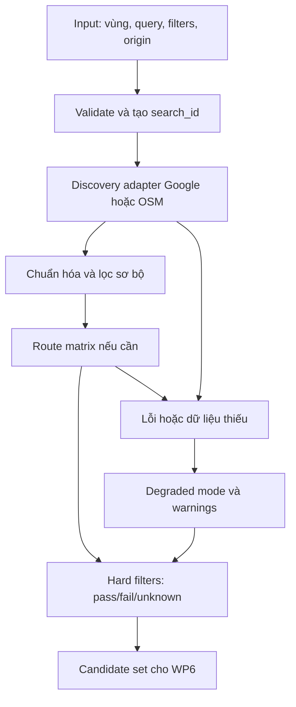

# WP2 — Map and Restaurant Discovery tại TP.HCM

**Phụ trách:** Trần Danh Thiện  
**Ngày đối chiếu tài liệu:** 28/10/2026  
**Trạng thái:** Đề xuất kỹ thuật có nguồn chính thức; chưa chạy benchmark Places/Routes có xác thực.

> Các tọa độ trong ví dụ là điểm thử nghiệm xấp xỉ tại TP.HCM, không phải địa chỉ/cửa vào đã xác minh. Quán A–E, rating, số lượng kết quả và thời gian đi là dữ liệu giả lập để minh họa xử lý, không phải kết quả API thực tế. Không suy diễn tỷ lệ coverage từ các ví dụ này.

## 1. Câu hỏi, phạm vi và kết luận

**Câu hỏi:** Làm thế nào lấy các quán phù hợp trong vùng người dùng chọn, tính khoảng cách hoặc thời gian đi, và xử lý giới hạn dữ liệu/API?

**Đầu ra WP2:** một candidate set có định danh nguồn, vị trí, trạng thái thỏa điều kiện, distance/time nếu có, dữ liệu thiếu và mức đầy đủ của kết quả. WP6 nhận để phối hợp dữ liệu menu và ranking; thứ tự do nhà cung cấp trả về không phải ranking cuối.

**MVP đề xuất:** Google Map + Places API (New) + Routes API; giới hạn vùng thử nghiệm và ngân sách. Chọn vì có tìm từ khóa, loại quán, rating và routing trong một hệ sinh thái, không chỉ vì phổ biến. Việc chấp nhận phương án phụ thuộc nhóm có bật billing và chấp nhận hạn chế lưu dữ liệu Google.

**Fallback:** chuyển toàn bộ phiên tìm kiếm sang nguồn OSM + Overpass + openrouteservice (ORS); bản đồ OSM dùng dịch vụ tile có chính sách phù hợp. Geocoding chỉ cần khi nhập địa chỉ; ưu tiên Nominatim hosted/self-host thay vì phụ thuộc endpoint public. Fallback không bảo đảm tương đương rating hoặc tìm món.

**Ngoài phạm vi:** thiết kế UI bản đồ chi tiết, OCR thực đơn, budget món ăn, thuật toán ranking cuối. Không khẳng định các API có thực đơn đầy đủ hoặc dữ liệu độ đông thời gian thực.

## 2. Input và các khái niệm phải tách biệt

| Trường | Ý nghĩa | Quy tắc MVP đề xuất |
| --- | --- | --- |
| `user_location` | GPS hiện tại kèm `accuracy_m`, thời điểm đo | Không bắt buộc; từ chối quyền vẫn tìm bằng điểm chọn |
| `search_center` | Tâm lấy từ GPS hoặc chọn trên map | Không tự đổi thành vị trí GPS sau khi người dùng đã chọn |
| `search_area` | `circle` hoặc `bbox` | Chỉ một dạng có hiệu lực trong một request |
| `radius_m` | Bán kính địa lý quanh tâm | Mặc định 1.000 m; MVP cho 200–3.000 m, đây là giới hạn sản phẩm |
| `bbox` | `south, west, north, east` của khung nhìn | Backend kiểm tra hợp lệ, giới hạn vùng thử nghiệm |
| `route_origin` | Điểm bắt đầu đi tới quán | Độc lập với `search_center`; thiếu thì không tính route |
| `query` | Ví dụ “cơm tấm”, “phở”, “cà phê” | Chuẩn hóa khoảng trắng/Unicode; giữ nguyên câu gốc |
| `categories` | Nhóm nhà hàng/café/fast food | Có bảng ánh xạ riêng cho Google và OSM |
| `min_rating` | Rating tối thiểu nếu người dùng yêu cầu | Không có thì không tự tạo ngưỡng |
| `travel_mode` | WALK/DRIVE hoặc chế độ được xác minh hỗ trợ | MVP dùng WALK để dễ kiểm thử; xe máy là mở rộng riêng |
| `max_duration_s` | Thời gian đi tối đa | Hard filter chỉ kiểm tra bằng route đúng phương thức |
| `open_now` | Có bắt buộc đang mở hay không | Thiếu giờ mở cửa là unknown, không tự coi là đang mở |
| `search_id` | Định danh truy vấn bất biến | Gắn với vùng, query, filters, origin, mode |

**Ba khoảng cách khác nhau:** `distance_from_search_center_m` để kiểm tra bán kính; `straight_line_from_origin_m` để mô tả khoảng cách trực tiếp từ điểm đi; `route_distance_m` là quãng đường theo mạng đường. Không thay thế lẫn nhau.

**Minh họa TP.HCM:** người dùng đứng gần cơ sở HCMUS đường Nguyễn Văn Cừ, kéo map sang khu Bến Thành. Tâm tìm kiếm chuyển sang Bến Thành nhưng `route_origin` vẫn ở điểm xuất phát Nguyễn Văn Cừ, trừ khi người dùng chọn lại. Vì vậy “quán trong vùng 1 km quanh Bến Thành” không có nghĩa “quán cách người dùng 1 km”.

## 3. So sánh đúng hai phương án bằng cùng tiêu chí

| Tiêu chí | Google Maps Platform | OSM + Nominatim + Overpass + ORS |
| --- | --- | --- |
| Bản đồ | Google Map khi biểu diễn kết quả Places trên map | OSM qua tile provider phù hợp; thư viện map chỉ là công cụ hiển thị |
| Tìm địa chỉ | Geocoding hoặc Places Autocomplete tùy luồng; SKU riêng | Nominatim forward/reverse geocoding; không dùng làm bộ tải POI |
| Restaurant search | Nearby Search theo type; Text Search theo từ khóa [S1][S2] | Overpass lọc tag, ví dụ `amenity=restaurant/cafe/fast_food` [S8] |
| Nearby search | Nearby dùng circle; radius API tối đa 50.000 m [S1] | Overpass `around` với bán kính mét [S8] |
| Visible area | Text Search có rectangle restriction; category query thích hợp [S2] | Overpass bbox; kiểm tra lại điểm đại diện nằm trong vùng |
| Tìm món | Text Search có thể tìm “cơm tấm”; chưa chứng minh món hiện có | Tag `cuisine` và tên nếu có; độ thiếu dữ liệu cao, cần menu xác minh |
| Rating | Có `rating`, `userRatingCount`; yêu cầu trường này kích hoạt Enterprise [S1] | Không có nguồn rating chuẩn tương đương trong pipeline này; để null |
| Route/time | Compute Routes cho tuyến; Compute Route Matrix cho nhiều đích [S5] | ORS Directions và Matrix; dữ liệu mạng đường dựa OSM [S12] |
| Coverage | Kiểm tra theo tính năng/quốc gia; không cam kết mọi quán TP.HCM [S6] | Tùy độ đầy đủ POI, đường, tag và cập nhật địa phương |
| Giới hạn số kết quả | Nearby ≤20; Text Search hiện ≤60 qua các trang, có thể thay đổi [S1][S2] | Tùy timeout/tài nguyên instance, không có bảo đảm lấy đủ từ public server |
| Quota/chi phí | Pay-as-you-go theo SKU; Matrix theo element [S3][S5] | Dữ liệu mở không đồng nghĩa hosting miễn phí/vô hạn; quota riêng từng dịch vụ |
| Terms/lưu dữ liệu | Hạn chế lưu/cache, attribution; map phải phù hợp [S4][S7] | ODbL + attribution; thêm chính sách geocoder, tile, routing [S10][S11][S14] |
| Công triển khai — nhận định | Ít hệ thống hơn; phải kiểm soát FieldMask/billing | Nhiều adapter, normalize tag, vận hành và thiếu rating |
| Phù hợp MVP | Tốt khi cần rating và có billing | Tốt cho thử nghiệm dữ liệu mở/nguồn thay thế, chấp nhận suy giảm tính năng |

Không cần hướng thứ ba: hai hướng đã thể hiện rõ đánh đổi dữ liệu giàu nhưng bị ràng buộc sử dụng so với dữ liệu mở nhưng cần ghép dịch vụ.

### 3.1. Nguyên tắc chọn tech: xét đúng vai trò trước khi so sánh

Không có một công nghệ đơn lẻ thay thế toàn bộ pipeline. Cần tách bốn lớp để tránh so sánh sai chức năng:

| Lớp | Câu hỏi nó giải quyết | Công nghệ trong đề xuất | Không thể thay bằng |
| --- | --- | --- | --- |
| Hiển thị bản đồ | Người dùng chọn điểm/vùng nào? | Google Maps JavaScript API; Leaflet cho fallback OSM trên web | Places/Overpass không tự tạo giao diện map |
| Geocoding | Địa chỉ này có tọa độ nào? | Google Geocoding/Autocomplete nếu cần; Nominatim hosted/self-host | GPS không giải mã tên địa chỉ; Nominatim không thay discovery toàn vùng |
| Discovery | Trong vùng có những quán ứng viên nào? | Places hoặc Overpass | Leaflet/MapLibre không cung cấp kho quán hay rating |
| Routing | Từ origin tới quán mất bao xa/bao lâu? | Routes hoặc ORS | Haversine không biết cầu, đường một chiều, lối vào |

**Quyết định có điều kiện:** Google là lựa chọn chính cho bài toán có rating và giới hạn thời gian phát triển; OSM có lợi thế nếu ưu tiên quyền chủ động dữ liệu. Chưa có benchmark chứng minh Google nhanh hơn, chính xác hơn hoặc bao phủ TP.HCM tốt hơn. Nhận định về công tích hợp dưới đây là đánh giá thiết kế, không phải số đo hiệu năng.

### 3.2. Vì sao chọn Google Map + Places API (New) cho MVP?

**Ưu điểm gắn với yêu cầu:**

- Nearby và Text Search giải quyết hai kiểu truy vấn khác nhau: “nhà hàng quanh đây” và “cơm tấm trong vùng này”. Có tọa độ/ID để tạo candidate set, có rating nếu yêu cầu đúng trường [S1][S2].
- Cùng hệ sinh thái giúp giảm số bộ định danh và adapter giữa discovery/routing. Place ID là khóa nguồn ổn định để tham chiếu; vẫn phải kiểm tra khả năng join menu, không xem ID là bảo đảm menu có sẵn.
- FieldMask cho phép giới hạn dữ liệu tải về và biết trường nào làm tăng SKU. Đây là công cụ kiểm soát chi phí, không làm mọi request trở nên miễn phí [S1][S3].
- Với bản web mới, chọn Google Maps JavaScript API cho lớp hiển thị vì kết quả Places trên map phải dùng Google Map [S4][S20]. Đây vừa là quyết định tích hợp vừa là ràng buộc sử dụng dữ liệu.

**Nhược điểm và hệ quả:**

- Rating nâng SKU, routing nhiều quán tính nhiều element; số thao tác nhỏ vẫn có thể tạo chi phí đáng kể. Cần hạn mức backend và đo chi phí mỗi search, không chỉ đếm request HTTP.
- Kết quả search bị giới hạn và có thứ tự của provider; WP6 chỉ xếp hạng trong tập đã tìm thấy, không được tuyên bố tối ưu trên mọi quán trong vùng.
- Hạn chế lưu/cache làm giảm khả năng xây kho dữ liệu nghiên cứu lâu dài. Nếu đồ án cần dataset tái lập/phát hành hoặc training, phải đánh giá nguồn dữ liệu khác trước, không coi việc “đã trả tiền API” là quyền sử dụng vô hạn.
- Có phụ thuộc provider. Giải pháp là interface đầu ra chung và provenance; không có nghĩa có thể trộn dữ liệu sang bất kỳ map nào.

**Vì sao không chọn OSM làm nguồn chính ngay?** Trong yêu cầu hiện tại có rating và truy vấn món; pipeline OSM này không cung cấp rating tương đương, còn cuisine/tag có thể thiếu. Chọn OSM chính sẽ buộc nhóm bỏ/đổi chức năng hoặc xây nguồn bổ sung, làm tăng phạm vi. Nếu nhóm quyết định rating chỉ là tùy chọn và cần lưu POI lâu dài, lý do này yếu đi và OSM đáng trở thành nguồn chính.

**Vì sao không chọn một nhà cung cấp thương mại thứ ba ngay?** Chưa có yêu cầu bắt buộc hoặc bằng chứng coverage/giá tại TP.HCM cho thấy cần mở thêm hướng. Mỗi hướng mới làm tăng công kiểm tra terms, benchmark và ánh xạ. Đây là quyết định giới hạn phạm vi nghiên cứu, không phải kết luận các nhà cung cấp khác kém hơn. Nếu Google không qua được điều kiện budget/terms và OSM không đủ chức năng, lúc đó mới nghiên cứu hướng thứ ba theo cùng bảng tiêu chí.

### 3.3. Vì sao dùng cả Nearby Search và Text Search, không chỉ một API?

| Tình huống | Chọn | Ưu điểm | Hạn chế chấp nhận và cách xử lý |
| --- | --- | --- | --- |
| Nhà hàng trong circle 1 km quanh Nguyễn Văn Cừ, không có query món | Nearby Search | Circle/type khớp trực tiếp input; không cần tự tạo câu query | Tối đa 20; báo not_exhaustive, không dùng như phép liệt kê đầy đủ |
| “Cơm tấm” quanh cùng điểm | Text Search | Nhận query văn bản; Nearby không có tham số free-text tương đương | Text match chưa xác minh món; rectangle bao circle rồi lọc hình học |
| Search this area quanh Bến Thành | Text Search với rectangle | Bounds khớp khung nhìn; không cần mở circle ngoài viewport | Giới hạn trang, type filtering có thể giảm recall; ghi cấu hình và coverage |

**Không chọn Nearby cho mọi truy vấn:** không giải quyết trực tiếp free-text món và rectangle. **Không chọn Text Search cho mọi truy vấn:** circle/type đã có Nearby phù hợp hơn về biểu diễn input; Text Search có thêm phụ thuộc cách diễn đạt. Đây là lựa chọn khớp semantics, chưa phải khẳng định Nearby luôn rẻ hoặc nhanh hơn.

**Không dùng Place Details để tìm danh sách quán:** Details bổ sung thông tin cho một place đã biết, không thay endpoint tìm kiếm. Chỉ gọi Details khi ứng viên cần trường chưa lấy và nhu cầu đó đáng chi phí. Không gọi Details cho mọi quán theo thói quen.

**Không bắt đầu bằng Places/Directions/Distance Matrix Legacy:** tài liệu Google đã đưa các dịch vụ tương ứng vào Legacy và cung cấp hướng thay thế [S16]. Dự án mới chọn Places (New) và Routes để tránh thêm công migration. Legacy không đồng nghĩa mọi ứng dụng cũ ngừng hoạt động; không dùng lập luận sai đó để bảo vệ quyết định.

### 3.4. Vì sao chọn Routes Matrix, không gọi từng tuyến hoặc chỉ Haversine?

**Chọn Compute Route Matrix** cho bước so sánh 1 origin với nhiều quán: phù hợp đầu ra distance/time theo cặp; xử lý được lỗi riêng từng element [S5][S13]. Với 10 quán, request 1×10 thuận tiện hơn quản lý 10 request tuyến độc lập. Tuy nhiên vẫn tính 10 element, nên gom batch không tự làm giảm đơn giá/element.

**Chọn Compute Routes khi đã chọn một quán** và cần chi tiết tuyến/polyline. Không lấy geometry của mọi ứng viên khi WP6 chỉ cần distance/time, vì tăng dữ liệu và công xử lý không phục vụ nhiệm vụ hiện tại.

**Giữ Haversine như bước kiểm tra hình học:** nhanh, không cần gọi dịch vụ, đủ kiểm tra radius địa lý khi tọa độ hợp lệ. Không chọn nó làm routing: tại TP.HCM, hai điểm gần nhau qua sông/kênh vẫn có thể đi vòng. Ước lượng `distance/speed` chỉ được đưa ra dưới một loại dữ liệu ước lượng riêng nếu sau này sản phẩm cần; MVP để time=null khi không có route.

**Chưa bật traffic và xe máy mặc định:** tăng độ phức tạp mode/coverage/SKU; hiện MVP đang kiểm chứng WALK. Đây là thu hẹp MVP, không phải nhận định đi bộ phù hợp với mọi người dùng TP.HCM. Nếu khảo sát yêu cầu cho thấy xe máy là cốt lõi, phải nâng phạm vi mode, kiểm coverage, giá, cảnh báo của provider và kiểm thử route trước demo; không lấy kết quả WALK làm đại diện.

### 3.5. Vì sao chọn OSM + Overpass + Nominatim cho fallback?

**OSM là nguồn dữ liệu, không phải một API tìm quán hoàn chỉnh.** Ưu điểm là có thể khai thác và tổ chức dữ liệu theo ODbL, chủ động chọn hạ tầng; nhược điểm là độ đầy đủ tên/địa chỉ/cuisine/giờ mở thay đổi theo từng khu vực. Dữ liệu mở giúp có phương án chủ động, không bảo đảm quán luôn đầy đủ hoặc đúng.

**Chọn Overpass cho discovery:** hỗ trợ điều kiện tag và vùng trực tiếp, đủ để thử POI tại Bến Thành mà chưa xây database địa lý riêng [S8]. Nhược điểm là query có thể tốn tài nguyên, public instance không có SLA ứng dụng và giới hạn kết quả không giống Places. Khắc phục bằng vùng nhỏ, timeout, endpoint cấu hình được, và hosted/self-host/extract nếu cần vận hành [S9].

**Chọn Nominatim khi cần geocoding:** phù hợp bước chuyển địa chỉ thành tọa độ; không gọi khi GPS hoặc pin đã có tọa độ. Ưu điểm của cách dùng tối thiểu là bớt request và bớt phụ thuộc. Nhược điểm là không giải quyết autocomplete ở public endpoint và không thay Overpass để liệt kê POI [S10]. Đề xuất hosted/self-host là lựa chọn vận hành; chỉ quyết định endpoint sau khi kiểm giá và terms, không tự hứa quota.

**Vì sao chưa xây PostGIS/database POI riêng?** Quản lý extract, nhập dữ liệu, chỉ mục và cập nhật là công việc vận hành thêm; chưa cần để chứng minh luồng WP2. Khi cần tìm vùng thường xuyên, dữ liệu tái lập hoặc public Overpass không đáp ứng, đây là hướng nâng cấp hợp lý. Không loại bỏ database vì “không hỗ trợ”, mà trì hoãn vì công quản trị chưa tương xứng quy mô MVP.

### 3.6. Vì sao đề xuất ORS thay OSRM cho routing fallback?

ORS có Matrix và các lựa chọn routing/profile trong bộ tài liệu, phù hợp thử luồng nhiều điểm đến và WALK [S12][S15][S21]. Lợi ích được kỳ vọng là dùng dịch vụ cấu hình sẵn thay vì tự dựng engine ngay. Điều kiện quan trọng: phải xác nhận endpoint hosted thực hỗ trợ profile và quota/terms; khả năng của backend mã nguồn mở không tự chứng minh khả năng tài khoản hosted.

**Nhược điểm ORS:** thêm provider/key và điểm lỗi; quota/terms hiện chưa được xác minh; network OSM và dữ liệu tốc độ không phải bằng chứng có traffic trực tiếp tại TP.HCM. Vì thế ORS là đề xuất có điều kiện, chưa phải fallback production đã sẵn sàng.

**OSRM là thay thế hợp lệ:** có Route và Table distance/duration, không bị loại vì thiếu matrix [S17]. Chưa chọn làm mặc định vì mục tiêu hiện tại là một dịch vụ routing fallback cho WALK có xác nhận cấu hình; tự vận hành OSRM đòi hỏi chuẩn bị dữ liệu/profile và quản trị, còn endpoint demo không được mặc định là dịch vụ production. Đây là đánh giá công triển khai, chưa có benchmark ORS thắng OSRM. Nếu nhóm đã vận hành OSRM, kiểm chứng đúng profile và cần chủ động hạ tầng, có thể thay ORS mà không đổi schema WP6.

**Điều kiện chốt ORS:** xác nhận profile WALK, hạn mức, attribution/terms, đo lỗi và latency trong vùng demo. Chưa qua điều kiện này thì trạng thái routing fallback là unavailable; vẫn có thể discovery OSM và trả distance trực tiếp. Không xem fallback thiếu time là thay thế ngang tính năng khi max_duration là hard.

### 3.7. Vì sao chọn Leaflet cho bản đồ fallback, chưa cần MapLibre?

Đây là đề xuất cho **bản web**, chỉ chọn công cụ, không thiết kế UI chi tiết. Leaflet cung cấp map, tile layer, marker và sự kiện cần cho pin/bounds; phù hợp hiển thị một lượng nhỏ ứng viên của MVP [S18]. Nó không cung cấp dữ liệu quán, geocoding hay route; vẫn cần provider ở các lớp khác.

MapLibre GL JS dùng WebGL để hiển thị vector tiles [S19]. Có giá trị khi cần vector styling sâu, lớp dữ liệu lớn hoặc cách biểu diễn phức tạp; các nhu cầu này chưa có trong WP2 hiện tại. Chưa chọn vì không cần thêm pipeline style/vector tiles cho bản fallback đơn giản, không phải vì MapLibre thiếu chức năng tìm vùng. Nếu dự án đã dùng MapLibre ổn định, giữ công cụ đó thay vì chuyển sang Leaflet chỉ để khớp báo cáo.

Cả hai thư viện đều không miễn trừ phí/quota/attribution của nguồn tile. Không dùng Leaflet/MapLibre làm cách hiển thị marker Google Places trên nền OSM trái chính sách [S4]. Nếu sản phẩm là mobile native, quyết định SDK hiển thị phải xem lại theo nền tảng; các quyết định discovery/routing vẫn giữ được.

### 3.8. Kết luận quyết định và các điều kiện đảo chiều

Không chấm điểm tổng tùy ý để tạo cảm giác Google thắng bằng số liệu. Dùng điều kiện bắt buộc trước, rồi xét đánh đổi trong cùng điều kiện:

| Điều kiện quyết định | Google | OSM stack | Kết luận |
| --- | --- | --- | --- |
| Cần rating ngay, không xây nguồn rating riêng | Có trường API, phải trả đúng SKU | Không có nguồn tương đương trong đề xuất | Ưu tiên Google nếu terms/budget chấp nhận |
| Phải lưu/phát hành dataset POI lâu dài | Phụ thuộc hạn chế và ngoại lệ điều khoản | Có hướng thực hiện theo ODbL | Ưu tiên nghiên cứu OSM chính |
| Không chấp nhận bật billing | Không qua điều kiện vận hành MVP Google | Vẫn phải kiểm hosting/quota; không mặc định miễn phí | Thu hẹp tính năng và xác nhận hạ tầng OSM |
| Demo cần time như hard filter | Routes phải hoạt động đúng mode | ORS phải qua kiểm chứng; distance-only không đủ | Không provider nào được giả vờ thỏa khi route thiếu |
| Coverage vùng TP.HCM không đạt qua benchmark | Phải điều chỉnh nguồn/phạm vi | Phải điều chỉnh nguồn/phạm vi | Kết quả đo có thể đảo lựa chọn ban đầu |

**Lập luận bảo vệ lựa chọn:** với scope tìm quán có rating trong vùng, Google giảm số thành phần tích hợp và có trường dữ liệu cần thiết; nhóm chấp nhận chi phí cùng ràng buộc lưu/map. OSM giữ vai trò phương án dữ liệu mở, được chuyển sang theo phiên và có thông báo mất tính năng. Quyết định không dựa vào thương hiệu; đổi yêu cầu về rating, quyền dữ liệu, ngân sách hoặc kết quả benchmark thì phải đổi đánh giá.

**Rủi ro của chính thiết kế hai stack:** làm đủ cả hai có thể tăng đáng kể công triển khai. Ưu tiên hoàn thiện Google end-to-end, rồi thử OSM discovery + schema, sau cùng mới bật route fallback khi kiểm chứng xong. Báo cáo có thể mô tả hai hướng đầy đủ, nhưng trạng thái demo phải ghi trung thực phần nào đã triển khai, phần nào mới là kế hoạch.

## 4. Giá, quota và biện pháp kiểm soát cụ thể

### 4.1. Google: tính đúng SKU và element

Giá toàn cầu tham chiếu, USD, bậc đầu sau miễn phí; không bao gồm thuế và các dịch vụ khác [S3]. Free cap là theo tháng/SKU, không phải tổng quota chung.

| SKU | Miễn phí/tháng | Giá /1.000 đơn vị sau miễn phí |
| --- | ---: | ---: |
| Nearby Search Pro | 5.000 request | 32 USD |
| Text Search Pro | 5.000 request | 32 USD |
| Nearby Search Enterprise | 1.000 request | 35 USD |
| Text Search Enterprise | 1.000 request | 35 USD |
| Route Matrix Essentials | 10.000 element | 5 USD |
| Route Matrix Pro | 5.000 element | 10 USD |
| Route Matrix Enterprise | 1.000 element | 15 USD |

Rating và số lượt đánh giá thuộc Enterprise; không dự toán request có rating bằng đơn giá Pro. Một request chịu SKU tương ứng tính năng/trường cao nhất áp dụng, không cộng Pro và Enterprise cho chính request đó [S1][S2][S3].

**Ví dụ ngân sách:** giả sử một tháng có 2.000 lượt Text Search Enterprise, mỗi lượt 1 trang, mỗi lượt route tới 10 quán bằng Matrix Essentials. Chi phí hai phần này là `(2.000−1.000)/1.000×35 + (20.000−10.000)/1.000×5 = 85 USD`. Đây là mô hình tính, không phải hóa đơn dự báo đã đo. Thêm trang tìm kiếm, tải map, geocoding, details, ảnh, traffic hoặc xe máy có thể tăng chi phí.

Matrix: 1 origin × 10 destinations = 10 element. Giới hạn tài liệu là tối đa 625 element với trường hợp thông thường; TRANSIT hoặc TRAFFIC_AWARE_OPTIMAL tối đa 100; rate limit được công bố 3.000 element/phút. Tính năng nâng cao đổi SKU; traffic-aware thuộc Pro và two-wheel thuộc Enterprise [S5].

**Biện pháp triển khai:**

1. Request trường tối thiểu; không dùng FieldMask `*` ở production. Nếu không có nhu cầu rating, dùng bộ trường Pro; có rating hoặc WP6 cần rating thì bật cấu hình Enterprise và ghi nhận chi phí.
2. Mặc định 20 kết quả/trang, tối đa 2 trang Text Search/phiên trong MVP. Giới hạn này là lựa chọn sản phẩm, có thể bỏ sót quán. Không chia lưới để thu thập toàn bộ dữ liệu Google.
3. Lọc tọa độ, loại và rating trước routing. MVP tính route tối đa 20 ứng viên còn lại; nếu vượt phải ghi `route_coverage=partial`, không ngầm coi phần chưa tính là không tới được.
4. Đặt quota API trong Cloud Console và bộ đếm chi phí ở backend. Ngân sách cảnh báo không phải công tắc tự ngắt; backend cần chặn phát sinh request mới khi chạm hạn mức nội bộ.
5. Không gọi khi kéo map liên tục; chỉ gọi khi Search this area. Chặn nút trùng khi đang có cùng request; hủy request cũ nếu có thể.
6. API key web giới hạn referrer/API; key server giới hạn API và IP khi phù hợp, không gửi key server ra client. Không ghi key vào repository.

### 4.2. OSM: phân biệt dữ liệu mở và hạ tầng public

**Nominatim public:** tối đa 1 request/giây tính cho toàn ứng dụng, không phải mỗi người; cần User-Agent/Referer nhận diện, attribution và khả năng chuyển endpoint. Không autocomplete, không lấy danh sách POI toàn vùng. Chính sách còn có điều kiện sử dụng qua công cụ tạo ứng dụng: chỉ dùng khi nhà phát triển chủ động lựa chọn và chịu trách nhiệm. Vì vậy đề xuất không tích hợp public endpoint mặc định; dùng GPS/chọn map không cần geocoding, hoặc chọn hosted/self-host sau khi kiểm tra terms [S10].

**Overpass public:** giới hạn tài nguyên, có 429/504; hướng dẫn khoảng 10.000 request/ngày và dưới 1 GB/ngày không phải SLA/quota bảo đảm. Nhà vận hành khuyến nghị tự vận hành khi app phụ thuộc vào dịch vụ [S9]. Demo cá nhân có thể truy vấn nhỏ, có kiểm soát; fallback vận hành thực tế cần hosted/self-host hoặc dữ liệu extract cục bộ.

**ORS:** endpoint Matrix có distance/time [S12]. Trang plans chính trả 404 trong lần kiểm tra; số quota trên staging trong nghiên cứu trước không đủ để chốt. Trước khi triển khai phải xác nhận plan, hạn mức, attribution và điều khoản tại tài khoản/provider thực dùng. Nếu không xác minh được thì fallback chỉ trả khoảng cách trực tiếp, time=null. Không ghi quota cũ như một cam kết hiện hành.

**Chi phí OSM cần dự toán riêng:** geocoder, tile provider, POI hosting/extract cập nhật, routing hosting, bộ nhớ và vận hành. Không đưa con số “0 USD production” khi chưa có cấu hình và báo giá.

## 5. Luồng input–process–output



### Bước 1 — Chọn tâm/vùng

Validate lat/lng, radius >0, bbox có thứ tự đúng, vùng nằm trong phạm vi MVP. Đề xuất ngưỡng GPS accuracy >100 m thì nhắc chọn điểm; tọa độ quá cũ thì yêu cầu cập nhật trước khi dùng làm origin. Đây là ngưỡng sản phẩm cần kiểm thử, không phải quy định của GPS/API.

### Bước 2 — Lấy candidate restaurants

- Không có món, có category: circle → Nearby Search; bbox → Text Search danh mục như “nhà hàng” với rectangle.
- Có món: Text Search theo query, type phù hợp và rectangle restriction. Với tìm hình tròn, tạo rectangle bao ngoài rồi backend lọc theo Haversine tới search_center.
- Không dùng locationBias như hard boundary: bias có thể trả ngoài vùng [S2]. Không tự gắn tên một khu khác vào query khi người dùng đã chọn vùng mới.
- OSM: query amenity tương ứng, lấy node/way/relation, normalize name/cuisine/opening_hours nếu có. Không yêu cầu cuisine trước ngay từ đầu nếu mục tiêu giữ recall, vì quán thiếu tag sẽ biến mất.

### Bước 3 — Chuẩn hóa và route

Loại trùng cùng provider ID; OSM dùng `{type}/{id}` vì node và way có thể trùng số ID. Hai đối tượng khác ID nhưng gần nhau chỉ gộp khi có bằng chứng tên/địa chỉ; giữ chi nhánh khác nhau. Way/relation `center` chỉ là điểm đại diện, không phải cửa vào hoặc centroid chính xác.

Chỉ gọi route khi có origin và mode phù hợp. Matrix trả distance/time; không nhất thiết có polyline. Khi người dùng chọn một quán và cần đường vẽ, mới gọi Compute Routes/Directions. Ghép kết quả Matrix theo chỉ số origin/destination, không dựa vào thứ tự nhận [S13].

### Bước 4 — Áp dụng hard filters

Mỗi điều kiện có trạng thái `pass`, `fail`, `unknown`. `fail` → loại; `unknown` của hard filter → đưa vào `pending_candidates`, không trộn vào danh sách đã đủ điều kiện. Thiếu trường của soft preference thì giữ và đánh dấu, không gán 0.

| Điều kiện | Dữ liệu xác minh | Nếu thiếu |
| --- | --- | --- |
| Trong radius/bbox | Tọa độ và phép kiểm tra hình học | Loại khỏi candidate hợp lệ do không thể định vị |
| Rating ≥4 | Rating cùng nguồn, count nếu có | Hard: pending; soft: giữ null |
| Đi bộ ≤15 phút | Duration của WALK từ đúng origin | Pending nếu route lỗi/chưa tính |
| Đang mở | Thông tin giờ/trạng thái phù hợp thời điểm | Unknown, không suy từ business operational |
| Có món “cơm tấm” | Bằng chứng menu từ bước phụ trách | Chuyển WP menu xác minh; text match chỉ là tín hiệu |

### Bước 5 — Chuyển WP6

Trả request context, candidates, pending_candidates, lý do loại tổng hợp, nguồn, giới hạn dữ liệu và trường thiếu. WP6 không coi danh sách rỗng do timeout là “không có quán”. Không hứa mọi hard filter món đã xong trước khi có dữ liệu menu.

## 6. Minh họa cụ thể tại TP.HCM

### 6.1. Tình huống A: tìm cơm tấm gần Nguyễn Văn Cừ

Điểm thử nghiệm gần khu HCMUS: `(10.7627, 106.6822)`, radius 1.000 m; query “cơm tấm”; rating ≥4 là hard; WALK ≤15 phút là hard. Hộp bao thử nghiệm dùng `south=10.7537, west=106.6730, north=10.7717, east=106.6914`. Backend vẫn kiểm tra lại hình tròn 1 km; hộp bao không phải vòng tròn.

Request minh họa Google Text Search:

```http
POST https://places.googleapis.com/v1/places:searchText
Content-Type: application/json
X-Goog-Api-Key: <SERVER_API_KEY>
X-Goog-FieldMask: places.id,places.displayName,places.location,places.formattedAddress,places.types,places.rating,places.userRatingCount,nextPageToken
```

```json
{
  "textQuery": "cơm tấm",
  "includedType": "restaurant",
  "strictTypeFiltering": true,
  "languageCode": "vi",
  "pageSize": 20,
  "locationRestriction": {
    "rectangle": {
      "low": {"latitude": 10.7537, "longitude": 106.6730},
      "high": {"latitude": 10.7717, "longitude": 106.6914}
    }
  }
}
```

Request có rating nên dự toán Enterprise. Backend tự lọc `rating >=4` để dùng cùng semantics với OSM/nguồn khác. Strict type filtering có thể giảm recall quán gắn type khác; ghi cấu hình này trong benchmark. Request mẫu chưa được gọi với API key.

**Kết quả giả lập để minh họa quyết định:**

| Quán giả lập | Cách tâm | Rating | Route WALK | Kết quả WP2 |
| --- | ---: | ---: | ---: | --- |
| A | 500 m | 4,3 | 9 phút | Đủ vị trí/rating/time; món chờ xác minh menu |
| B | 700 m | 3,8 | Chưa gọi | Loại vì rating; tiết kiệm 1 element |
| C | 1.150 m | 4,5 | Chưa gọi | Loại ngoài radius dù nằm trong bbox |
| D | 800 m | null | Chưa gọi | Pending rating; không gán 0 sao |
| E | 600 m | 4,2 | Không tìm được route | Pending time; không đổi thành 0 phút |

WP6 nhận A dưới trạng thái `pending_menu_verification`, chưa được tuyên bố “đã chắc chắn có cơm tấm”. D và E nằm trong pending riêng, kèm lý do. Nếu người dùng bỏ điều kiện rating, D có thể tiếp tục routing.

### 6.2. Tình huống B: Search this area ở khu Bến Thành

Người dùng giữ origin Nguyễn Văn Cừ và kéo sang vùng thử nghiệm quanh Bến Thành: `south=10.767, west=106.692, north=10.777, east=106.704`. Đây là bbox thử nghiệm, không phải ranh giới hành chính.

1. Khi kéo/zoom: chỉ cập nhật viewport; không gọi search theo mỗi frame.
2. Hiện “Search this area”; kết quả cũ được đánh dấu thuộc vùng trước.
3. Khi bấm: chụp bbox + query + filters + origin + mode thành `search_id=B` bất biến.
4. Query vùng Bến Thành. Không giữ chuỗi “gần Nguyễn Văn Cừ” trong textQuery cũ.
5. Nếu người dùng tìm tiếp ở khu Hồ Con Rùa, tạo `search_id=C`. Phản hồi B đến sau C bị bỏ; không ghi đè màn hình.
6. Các quán Bến Thành vẫn tính route từ origin Nguyễn Văn Cừ. Không tự chuyển origin thành tâm Bến Thành.
7. Vùng quá rộng → thông báo thu hẹp trước khi gọi API; không âm thầm cắt vùng.

Không tự tìm lại khi GPS nhúc nhích. Chỉ tạo search mới theo hành động được định nghĩa; origin dùng cho từng kết quả phải được giữ nhất quán.

### 6.3. Tình huống C: fallback OSM ở cùng vùng Bến Thành

Overpass QL minh họa, bbox theo thứ tự **south, west, north, east**:

```overpass
[out:json][timeout:15];
(
  nwr["amenity"~"^(restaurant|fast_food|cafe|food_court)$"]
     (10.767,106.692,10.777,106.704);
);
out center tags;
```

`nwr` lấy node, way và relation; node có tọa độ trực tiếp, way/relation cần điểm đại diện. Bộ tag là ánh xạ sản phẩm, không bao quát mọi loại địa điểm bán đồ ăn. Query này chưa chạy; không có kết luận số quán thực tế.

Sau khi lấy dữ liệu: chuẩn hóa tọa độ → kiểm tra bbox → dùng name/cuisine tạo tín hiệu query → route bằng ORS theo mode đã hỗ trợ → chuyển menu xác minh món. Thiếu rating giữ null. Nếu rating ≥4 vẫn là hard, fallback có thể không có candidate đủ điều kiện; báo “nguồn dự phòng chưa có rating để xác minh” và cho người dùng chủ động bỏ filter. Không lấy rating Google ghép sang bản đồ OSM như cách né hạn chế.

### 6.4. Tình huống D: gần về địa lý nhưng đi vòng

Thử hai điểm ở hai phía sông/kênh tại TP.HCM, ví dụ vùng trung tâm và khu Thủ Thiêm. Khoảng cách trực tiếp ngắn không chứng minh đường đi ngắn: còn phụ thuộc cầu, lối tiếp cận và mode. Không tạo time bằng `distance/velocity` rồi gắn nhãn route thật. Nếu chỉ còn Haversine, hiển thị “khoảng cách đường chim bay”, duration=null.

Google có tài liệu coverage two-wheel riêng [S6]; cần kiểm tra cấu hình và giá trước khi bật. Không dùng ORS driving-car hay cycling rồi gọi là thời gian xe máy.

## 7. Bảng lỗi và biện pháp vận hành

Các timeout/retry bên dưới là đề xuất ban đầu, phải điều chỉnh qua đo thực tế.

| Sự cố | Phát hiện | Biện pháp cụ thể | Đầu ra |
| --- | --- | --- | --- |
| Không có quán | API thành công nhưng rỗng | Cho chọn tăng 1→2 km hoặc bỏ filter; không tự nới | `status=empty`, lý do rõ |
| Tọa độ sai/thiếu | Validate và accuracy | Chọn pin thủ công, cập nhật GPS; không gọi route khi thiếu origin | `route_status=not_requested` |
| Quán ngoài vùng | Haversine/bbox check | Loại kể cả provider trả về | count loại `outside_area` |
| 429 tạm thời | HTTP code/provider status | Tôn trọng Retry-After nếu có; backoff+jitter, tối đa 2 retry trong deadline | `status=partial/error` |
| Hết quota/ngân sách | Bộ đếm và phản hồi quota | Không retry vô hạn; circuit breaker và chuyển mode có thông báo | `QUOTA_EXCEEDED` |
| 401/403/key lỗi | Phân loại xác thực | Dừng retry, log mã lỗi đã che secret, sửa cấu hình | `PROVIDER_AUTH_ERROR` |
| Timeout/5xx | Discovery deadline đề xuất 8 giây; route 5 giây | Retry giới hạn nếu còn deadline; giữ phần thành công | warning và partial |
| Một route lỗi | Element lỗi/null | Chỉ đánh dấu quán đó; giữ các route khác | `no_route` hoặc `provider_error` |
| API về cũ | search_id khác active | Bỏ phản hồi; không cập nhật UI/WP6 | không thay kết quả mới |
| POI trùng/sai cửa vào | ID, tên, tọa độ và kiểm tra tay | Gộp thận trọng; cờ location_quality; không tự dời pin | cảnh báo chất lượng |
| Provider bị lỗi liên tiếp | Đề xuất 5 lỗi trong 60 giây | Mở breaker 60 giây, sau đó thử lại có kiểm soát | fallback hoặc lỗi tường minh |
| Giờ mở/rating thiếu | Trường vắng/null | Ba trạng thái; không quy đổi unknown thành pass | pending hoặc soft missing |

Endpoint do backend quản lý; giới hạn tối đa 20 ứng viên route/phiên, 2 search đồng thời/người dùng là cấu hình MVP đề xuất. Không chia key/IP để vượt quota nhà cung cấp.

## 8. Terms, cache và dữ liệu bàn giao

### Google

- Places hiển thị trên map phải dùng Google Map; có attribution đúng. Nếu không có map vẫn cần attribution theo hướng dẫn [S4].
- Không coi nội dung Places là kho dữ liệu quán được sở hữu để lưu lâu dài. `place_id` có ngoại lệ lưu; các trường khác chỉ lưu/cache theo ngoại lệ và điều khoản áp dụng, không tự đặt “cache 30 ngày” cho toàn bộ payload [S4][S7].
- Candidate set là hợp đồng xử lý trong phiên, không phải giấy phép lưu database/training dataset. WP6 phải giữ provenance và không dùng nội dung Google để train mô hình nếu không được điều khoản cho phép.
- Không lưu raw response hoặc rating/name Google vào log phân tích dài hạn. Log vận hành tập trung mã lỗi, latency, count và usage không chứa nội dung hạn chế/GPS không cần thiết.
- Điều khoản được viện dẫn dành cho tài khoản ngoài EEA; nếu billing account thuộc EEA, phải đối chiếu bộ terms tương ứng [S7].

### OSM và fallback

- Ghi “© OpenStreetMap contributors”, dẫn license; dữ liệu OSM theo ODbL, cơ sở dữ liệu dẫn xuất khi phân phối có thể phát sinh nghĩa vụ share-alike. Không diễn giải thành “mọi source code phải mở” [S11].
- Cache dữ liệu OSM phù hợp license, provider và cơ chế cập nhật; không mặc định mọi API trả dữ liệu mở đều cho phép mọi kiểu truy cập.
- Tile OSM public có chính sách riêng; không dùng bulk download/offline tùy ý [S14].
- Khi fallback, tạo search_id mới, đổi nguồn/map phù hợp và tải lại candidate set. Không chồng marker Places cũ lên OSM.

## 9. Hợp đồng đầu ra cho WP6

Tất cả dữ liệu JSON sau là giả lập. Candidate đủ điều kiện địa lý/rating/route vẫn có thể chờ menu; `WP2 hard_pass` không đồng nghĩa đủ điều kiện toàn hệ thống.

```json
{
  "schema_version": "1.0",
  "search_id": "hcm-demo-001",
  "status": "partial",
  "provider": "google",
  "context": {
    "search_area": {
      "type": "circle",
      "center": {"lat": 10.7627, "lng": 106.6822},
      "radius_m": 1000
    },
    "route_origin": {"lat": 10.7627, "lng": 106.6822},
    "travel_mode": "WALK",
    "query": "cơm tấm",
    "filters": {"min_rating": 4, "max_duration_s": 900}
  },
  "coverage": {
    "completeness": "not_exhaustive",
    "pagination_stopped_by_app": false,
    "route_coverage": "complete_for_retained_candidates"
  },
  "candidates": [
    {
      "candidate_id": "google:DEMO_A",
      "provider_place_id": "DEMO_A",
      "name": "Quán A — giả lập",
      "location": {"lat": 10.766, "lng": 106.685},
      "categories": ["restaurant"],
      "rating": {"value": 4.3, "count": 120, "source": "google"},
      "distance_from_search_center_m": 500,
      "straight_line_from_origin_m": 500,
      "route": {
        "provider": "google_routes",
        "mode": "WALK",
        "status": "ok",
        "distance_m": 650,
        "duration_s": 540,
        "traffic_aware": false
      },
      "hard_filter_results": {
        "inside_area": "pass",
        "min_rating": "pass",
        "max_duration": "pass"
      },
      "dish_match": {"status": "unverified", "evidence": "text_search_match"},
      "eligibility": "pending_menu_verification",
      "missing_fields": [],
      "provenance": {"provider": "google", "demo": true},
      "retention_policy": "provider_terms_apply"
    }
  ],
  "pending_candidates": [],
  "warnings": ["DEMONSTRATION_DATA", "DISCOVERY_NOT_EXHAUSTIVE"],
  "retrieved_at": "2026-10-28T12:00:00Z"
}
```

Các khoảng cách JSON được làm tròn phục vụ minh họa, không là kết quả tính từ tọa độ. Khi triển khai phải sinh bằng cùng hàm hình học và response route thực.

**Quy ước bắt buộc:**

- `null` khác 0; không route khác chưa gọi route.
- `status=empty`: tìm thành công không có ứng viên; `error`: chưa đủ dữ liệu kết luận; `partial`: có kết quả nhưng một phần thất bại/thiếu.
- `pending_candidates` chứa đối tượng cùng schema tối thiểu, thêm `pending_reasons`, ví dụ `missing_rating`, `missing_route`. Quán hard fail không đi vào candidates.
- `candidate_id` định danh theo provider, không tự giả định Google ID=OSM ID. Join với menu qua bảng định danh đã xác minh, không chỉ tên quán.
- WP6 kiểm tra source trước khi hiển thị/lưu/tái sử dụng. Không đưa raw data Google vào dữ liệu nguồn mở.
- Trường bổ sung khi production: provider attribution, thời điểm departure tính route, location_quality, phiên bản dữ liệu OSM nếu biết. Giá trị không biết phải ghi null, không chế tạo.

## 10. Quyết định MVP và điều kiện chuyển fallback

| Tình huống | Hành động |
| --- | --- |
| Có billing, cần rating | Google MVP; bộ trường Enterprise cần thiết |
| Google lỗi tạm thời | Retry giới hạn; quá deadline thì thông báo và đề xuất fallback |
| Hết budget | Dừng request Google mới; chuyển mode OSM rõ ràng khi người dùng tiếp tục |
| OSM thiếu rating nhưng rating là hard | Không có kết quả đã xác minh rating; chỉ nới khi người dùng chọn |
| ORS chưa có quota/terms xác minh | Fallback distance trực tiếp, time=null; không bật hard time như đã thỏa |
| Cả hai provider đều lỗi | Trả lỗi có thể thử lại; không trả “không có quán” |
| Muốn vận hành dài hạn bằng OSM | Chốt hosted/self-host/extract và quy trình cập nhật, không dựa public endpoint |

**Điều kiện xem lại lựa chọn:** nếu ngân sách không đủ hoặc dự án cần lưu kho POI lâu dài/huấn luyện trên dữ liệu địa điểm, đánh giá chuyển OSM làm nguồn chính. Nếu rating là chức năng bắt buộc, OSM đơn thuần không phải phương án thay thế ngang tính năng.

## 11. Kế hoạch kiểm chứng tại TP.HCM trước demo

Không có kết quả benchmark thực tế trong tài liệu này. Kế hoạch sau giúp kiểm chứng lựa chọn bằng dữ liệu.

| Vùng thử nghiệm | Bài kiểm tra | Dữ liệu cần ghi |
| --- | --- | --- |
| Gần HCMUS đường Nguyễn Văn Cừ | Circle 1 km, query cơm tấm/phở | Quán tìm thấy, sai vị trí, rating thiếu, quán ngoài circle bị loại |
| Quanh Bến Thành | Bbox, query nhà hàng/café | Search this area, kết quả giới hạn, request theo trang |
| Khu Hồ Con Rùa | Pan nhanh giữa hai viewport | Số request, phản hồi cũ bị bỏ, origin có bị đổi sai không |
| Hai phía sông/kênh, vùng Thủ Thiêm | Route so với đường chim bay | Route theo đúng mode, lỗi từng đích, time không bị thay bằng 0 |

**Mẫu đo đề xuất:** mỗi vùng xác minh độc lập 10–15 địa điểm bằng khảo sát hoặc dữ liệu được phép sử dụng; không dùng kết quả Google như bộ dữ liệu mở để đánh giá/làm giàu OSM. Chạy cùng tâm, vùng, query và mode cho hai hướng; ghi latency p50/p95, tỷ lệ thiếu field, tỷ lệ route thành công, số request/element và chi phí ước tính. Tỷ lệ tìm thấy trên tập mẫu chỉ là sample recall, không đại diện toàn TP.HCM.

**Tiêu chí chấp nhận chức năng:**

1. Mọi candidate hợp lệ nằm trong vùng theo hàm kiểm tra của backend.
2. Không có quán hard fail trong candidates; unknown không bị gán pass.
3. Route lỗi giữ null và reason; origin/mode khớp request context.
4. Pan map không gọi API; một lần Search this area tạo một search context mới.
5. Phản hồi cũ không ghi đè truy vấn mới.
6. Quota/error khác empty; retry có giới hạn.
7. WP6 parse được JSON và phân biệt candidate/pending/missing.
8. Ghi nguồn/map/cache đúng provider; không lộ API key.

Các chỉ số coverage/latency là kết quả cần đo, không điền số mục tiêu tùy ý rồi tuyên bố đã đạt.

## 12. Checklist đối chiếu yêu cầu WP2

| Yêu cầu/tiêu chí | Nội dung đáp ứng | Trạng thái tài liệu |
| --- | --- | --- |
| Input GPS/map-selected, tâm, radius/visible area | Mục 2 | Đủ |
| Query món/category, rating, yêu cầu rõ ràng | Mục 2, 5 | Đủ |
| Tối đa 2–3 hướng | Chỉ so sánh 2 hướng ở mục 3 | Đủ |
| Restaurant search và nearby/area search | Mục 3, 5, 6 | Đủ |
| Route/travel time | Mục 4, 5, 6.4 | Đủ |
| Coverage có nguồn và giới hạn | Mục 3, 11; không bịa benchmark | Đủ phân tích; cần đo trước demo |
| Quota/pricing | Mục 4 và ví dụ 85 USD | Đủ Google; ORS nêu rõ chưa xác minh plan |
| Terms/data-use restrictions | Mục 8 | Đủ phân tích; kiểm lại theo tài khoản thực |
| Quy trình 5 bước | Mục 5 | Đủ |
| Không quán, vị trí sai, API limit, thiếu route | Mục 7 | Đủ |
| Search this area rõ ràng | Mục 6.2 | Đủ |
| Một hướng MVP và một fallback có lý do | Mục 1, 10 | Đủ |
| Bảng so sánh cùng tiêu chí | Mục 3 | Đủ |
| Ưu/nhược từng tech gắn với yêu cầu | Mục 3.1–3.7 | Có lợi ích, giới hạn và hệ quả cụ thể |
| Lý do không chọn tech thay thế | Mục 3.2–3.7 | Có Nearby/Text, Legacy/New, Matrix/Routes/Haversine, ORS/OSRM, Leaflet/MapLibre |
| Quyết định có điều kiện, không dựa phổ biến | Mục 3.8, 10 | Có điều kiện đảo chiều; không bịa điểm benchmark |
| Sơ đồ input-process-output | Mục 5 | Đủ |
| Giới hạn/rủi ro/xử lý thiếu | Mục 4, 7, 8 | Đủ |
| Đầu ra cho WP6 | Mục 9 | Đủ schema và semantics |
| Minh họa TP.HCM và biện pháp cụ thể | Mục 6 và 11 | Đủ; ví dụ ghi rõ giả lập |
| Nguồn chính thức | Mục 13 | Đủ |
| Không lấn UI/OCR/budget/ranking | Mục 1, 5 | Đúng phạm vi |

Tài liệu đáp ứng deliverable nghiên cứu; không tuyên bố đã hoàn thành kiểm thử tích hợp API thật hoặc đo coverage. Những phần đó có kế hoạch và điểm kiểm chứng cụ thể để nhóm thực hiện.

## 13. Nguồn chính thức

Các đường dẫn dưới đây được đối chiếu trong nghiên cứu ngày 28/10/2026. Giá/quota/terms có thể đổi; kiểm lại trước triển khai. Trang ORS plans không truy cập được nên không dùng làm chứng cứ quota hiện hành.

| Mã | Nguồn | Dùng để xác minh |
| --- | --- | --- |
| S1 | [Google Nearby Search (New)](https://developers.google.com/maps/documentation/places/web-service/nearby-search) | Circle, result cap, FieldMask, rating SKU |
| S2 | [Google Text Search (New)](https://developers.google.com/maps/documentation/places/web-service/text-search) | Query, rectangle restriction/bias, pagination, type filter |
| S3 | [Google global pricing](https://developers.google.com/maps/billing-and-pricing/pricing) | Giá và free usage cap theo SKU |
| S4 | [Places policies and attribution](https://developers.google.com/maps/documentation/places/web-service/policies) | Cache, place ID, map và attribution |
| S5 | [Routes usage and billing](https://developers.google.com/maps/documentation/routes/usage-and-billing) | Element, quota, giới hạn matrix, SKU |
| S6 | [Two-wheeled coverage](https://developers.google.com/maps/documentation/routes/coverage-two-wheeled) | Coverage theo quốc gia cho xe hai bánh |
| S7 | [Google Service Specific Terms](https://cloud.google.com/maps-platform/terms/maps-service-terms) | Điều khoản theo dịch vụ và khu vực tài khoản |
| S8 | [Overpass manual](https://dev.overpass-api.de/overpass-doc/en/) | Truy vấn theo vùng và đối tượng OSM |
| S9 | [Overpass public instance resources](https://dev.overpass-api.de/overpass-doc/en/preface/commons.html) | Giới hạn tài nguyên và vận hành public |
| S10 | [Nominatim Usage Policy](https://operations.osmfoundation.org/policies/nominatim/) | 1 request/s, không autocomplete/bulk POI, lựa chọn có trách nhiệm |
| S11 | [OSM copyright and ODbL](https://www.openstreetmap.org/copyright) | License và attribution |
| S12 | [ORS Matrix endpoint](https://giscience.github.io/openrouteservice/api-reference/endpoints/matrix/) | Distance/time matrix |
| S13 | [Google Compute Route Matrix](https://developers.google.com/maps/documentation/routes/compute_route_matrix) | Lỗi từng element và ghép theo index |
| S14 | [OSM Tile Usage Policy](https://operations.osmfoundation.org/policies/tiles/) | Chính sách tile public |
| S15 | [ORS routing options](https://giscience.github.io/openrouteservice/api-reference/endpoints/directions/routing-options) | Tham số routing; kiểm tra profile phù hợp |
| S16 | [Google Legacy products](https://developers.google.com/maps/legacy) | Phân biệt Legacy với dịch vụ mới và trạng thái hỗ trợ |
| S17 | [OSRM API documentation](https://project-osrm.org/docs/v5.24.0/api/) | Route/Table, distance/duration và profile chuẩn bị dữ liệu; tài liệu version 5.24.0, cần đối chiếu version triển khai |
| S18 | [Leaflet API reference](https://leafletjs.com/reference) | Map, bounds, marker và tile layer |
| S19 | [MapLibre GL JS documentation](https://maplibre.org/maplibre-gl-js/docs/) | Hiển thị vector map với WebGL |
| S20 | [Google Maps JavaScript API overview](https://developers.google.com/maps/documentation/javascript/overview) | SDK hiển thị cho bản web |
| S21 | [ORS profiles](https://giscience.github.io/openrouteservice-r/reference/ors_profile.html) | Tên profile WALK và các mode; tài liệu client không thay xác nhận gói hosted |

**Thông tin còn phải xác minh khi triển khai:** quota/terms ORS và tile provider thực dùng; billing account và SKU phát sinh; chất lượng POI/route tại vùng demo; cơ chế join menu. Đây là các điểm mở được ghi nhận, không được thay bằng giả định có lợi.
