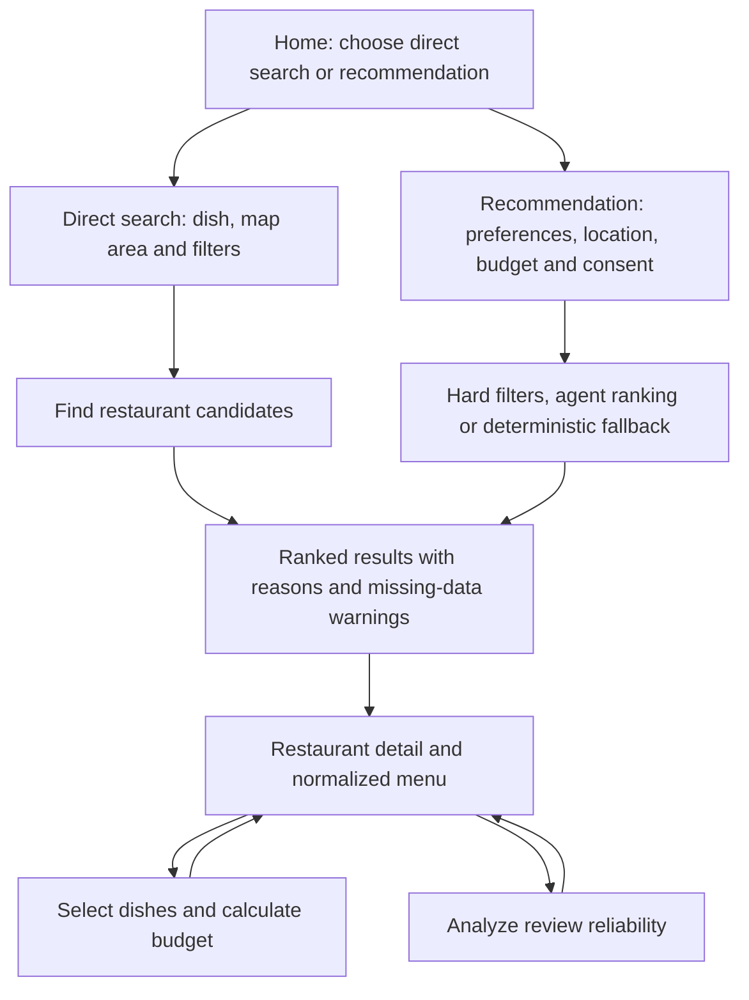

# Current System Pipeline

## 1. Current end-to-end flow

The two entry modes share the same result, restaurant-detail, menu, budget and review screens. Missing prices, menu evidence, routes or review evidence remain unknown/unverified and are not replaced with invented values.

## 2. Runtime behavior

### Direct search

1. The user enters a dish, budget and filters, then chooses a radius or visible map area.
2. The UI calculates distances from the selected map center and keeps the list and map synchronized.
3. Candidates outside the confirmed area are removed. Candidates with missing data remain visible as pending/unverified when appropriate.
4. Selecting a restaurant opens its detail and menu flow.

The current direct-search candidate set is the local frontend dataset. It is stable for UI demonstration but has not yet been replaced by the SQLite/external provider contract.

### Recommendation

1. The UI validates preferences, location, radius, budget, diner count and consent.
2. It converts the UI context to the shared `SearchContext` contract and calls `POST /api/v1/recommendations/detailed`.
3. The backend loads candidates from SQLite, calculates current distance, applies reliable hard filters and builds available signals.
4. The recommendation agent may rank only the supplied candidate IDs. Invalid or invented IDs are rejected.
5. If the AI API is missing or fails, deterministic ranking returns a valid result instead of breaking the flow.
6. Results preserve the backend ranking and show its reasons, used signals, missing signals and data warnings.

Local-first is the default and reproducible source. Live external discovery is opt-in with `ENABLE_EXTERNAL_PLACES=true` and `EXTERNAL_PLACES_API_URL`; otherwise the comparison uses deterministic external sample candidates.

### Menu, OCR and budget

1. Opening a restaurant requests `GET /api/v1/restaurants/{restaurantId}/menu`.
2. A stored normalized menu replaces the UI demo menu. If no menu is available, the UI keeps demo data and shows a warning rather than failing silently.
3. Dish variants and quantities are passed to the Budget screen to calculate total, per-person cost and budget difference.
4. `POST /api/v1/menus/ocr` accepts a menu image and supports `visual` or `textPipeline` processing.
5. OCR stores the source asset, run metadata, raw output and a new normalized menu version without overwriting previous runs.

OCR upload is available in the backend contract but does not yet have an upload control in the main UI. Real OCR requires the Faculty AI environment variables; the text pipeline also requires the Tesseract executable with Vietnamese and English language data.

### Review reliability

1. The Review Reliability screen calls `POST /api/v1/reviews/analyze` with the selected restaurant and method.
2. `textSimilarity` uses TF-IDF and cosine similarity; `metadataAnomaly` uses Isolation Forest; `combined` runs both.
3. The agent summarizes only detected signals. Without an agent service, the backend uses a safe local explanation.
4. Too little evidence returns `insufficient_evidence`; other results use cautious `normal` or `potentially_suspicious` wording.
5. The UI shows loading, result and provider-error states and supports retry.

## 3. Active API endpoints

| Endpoint | Purpose |
|---|---|
| `GET /api/v1/restaurants/search` | Existing restaurant discovery endpoint. |
| `POST /api/v1/recommendations` | Return the canonical ranked result. |
| `POST /api/v1/recommendations/detailed` | Return ranking plus execution/fallback metadata. |
| `GET /api/v1/recommendations/comparison` | Compare local-first and external-first strategies. |
| `GET /api/v1/restaurants/{restaurantId}/menu` | Load the active normalized menu. |
| `POST /api/v1/menus/ocr` | Process and store a menu image. |
| `POST /api/v1/reviews/analyze` | Run one or both review-reliability methods. |

The frontend uses `VITE_API_BASE_URL` when provided and otherwise connects to `http://127.0.0.1:8000`. CORS allows the frontend development origins and the `GET`, `POST` and `OPTIONS` methods.

## 4. Use-case coverage

| Use case | Current status |
|---|---|
| UC-01 Define request and search area | Implemented in both entry modes. |
| UC-02 Discover candidates | Direct UI flow implemented; SQLite/external provider is used by recommendation. |
| UC-03 Acquire and normalize menu | Backend OCR and stored-menu retrieval implemented; upload UI remains pending. |
| UC-04 Calculate cost and budget fit | Implemented after menu selection. |
| UC-05 Assess review reliability | Implemented with two methods, combined mode and safe fallback. |
| UC-06 Rank and explain results | Implemented with candidate validation and deterministic fallback. |
| UC-07 View and compare results | Implemented with ranked cards, comparison, menu, warnings and map in direct search. |
| UC-08 Submit feedback and refine | The UI entry point is present, but persistence and verification workflow remain pending. |

## 5. Verified integration state

- Frontend tests and production build pass.
- Backend tests for data, discovery, OCR, recommendation and review reliability pass.
- Local smoke test confirms recommendation, normalized menu retrieval and combined review analysis through the routers registered in `main.py`.
- Automated tests use fake/local agents and do not transmit request data to external AI services.
